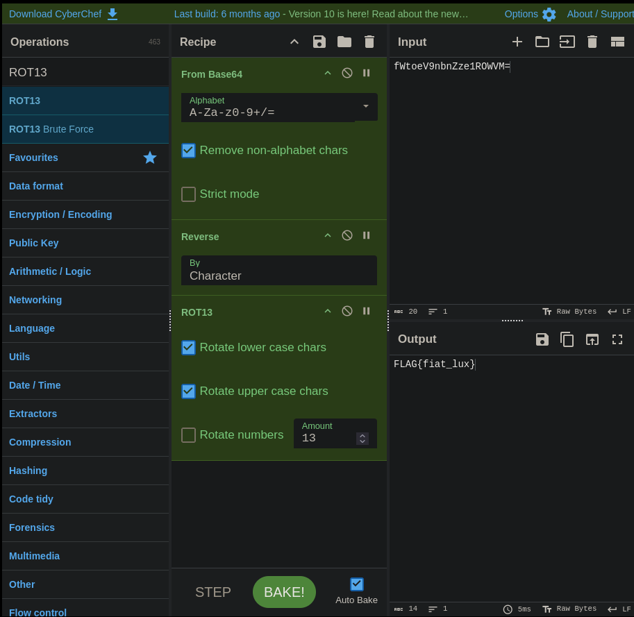

# Trust Challenge 

We have only an apk , we need to retreive an apk somehow 

___

## How to solve it 

### 1. JAD-GUI

we need to look at the manifest to look at entry point and also look at the maniffest to know whats happening 
look for exported=true components 

in this challenge 
- QUERY_ALL_PACKAGES
- android:debbugable="true"
- android:allowBackup=true 

hypothesis: if an app with package name com.example.trustedapp is installed, reveal the flag. 

lets look whats on MainActivity

```java
public void call_superapp() {
        Context appContext = null;
        try {
            appContext = createPackageContext("com.example.superapp", 3);
        } catch (PackageManager.NameNotFoundException e) {
            Log.i(TAG, "com.example.superapp is not installed");
        }
        if (appContext == null) {
            return;
        }
        Log.i(TAG, "calling the agent");
        ClassLoader classLoader = appContext.getClassLoader();
        String superSecretAnswer = "";
        try {
            superSecretAnswer = (String) classLoader.loadClass("com.example.superapp.Agent").getMethod("superSecretRequest", new Class[0]).invoke(null, new Object[0]);
        } catch (Exception e2) {
            Log.i(TAG, String.valueOf(e2));
        }
        if (superSecretAnswer.equals("s3cr37_c0mm")) {
            String flag = Util.decryptData();
            Log.i(TAG, flag);
        }
    }
```

appContext = createPackageContext("com.example.superapp", 3); -> tries to find another installed app with the pacjage name com.example.superapp 


classLoader.loadClass("com.example.superapp.Agent"). -> looks for a java class named agent inside that package 


getMethod("superSecretRequest", new Class[0]) -> tries to run a static method superSecretRequest that 
- checkpassword -> if returs string s3cr37_c0mm the app decrypt the glaf and prints it to the log 


### 2. what we need to do 

create a faje aoo that matches what the victim is loocking for 


1. create project name superapp, package name com.example.superapp
2. create the agent class 
3. create a funcction superSecretRequest()
```java
public class Agent {
    // The victim app calls this method dynamically
    public static String superSecretRequest() {
        // We return exactly what the victim app expects
        return "s3cr37_c0mm";
    }
}
```


see on the logcat 


```bash
2026-01-26 19:16:20.140 18251-18251 MOBIOTSEC               com.example.victimapp                I  calling the agent
2026-01-26 19:16:20.279 18251-18251 MOBIOTSEC               com.example.victimapp                I  nu uh not so easy, you want the flag? super secret salad dressing encryption method that makes your head spin ;)
2026-01-26 19:16:20.279 18251-18251 MOBIOTSEC               com.example.victimapp                I  figure this out, maybe a famous chef can cook a solution for you
2026-01-26 19:16:20.279 18251-18251 MOBIOTSEC               com.example.victimapp                I  I would let him cook if I were you
2026-01-26 19:16:20.279 18251-18251 MOBIOTSEC               com.example.victimapp                I  alright Ill stop talking, here is the encrypted flag fWtoeV9nbnZze1ROWVM=
2026-01-26 19:16:20.279 18251-18251 MOBIOTSEC               com.example.victimapp                I  fWtoeV9nbnZze1ROWVM=
```

famous chef -> means CyberChef -> populartook decoding data 
salad .> refer to a caesar ciper, typically is ised ROT13 

signature 
-> we get a has fWtoeV9nbnZze1ROWVM= , = means base64



FLAG{fiat_lux}